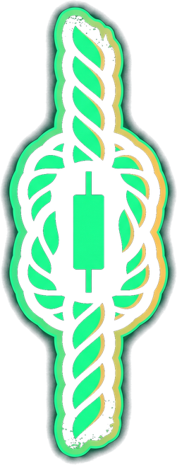

<p align="center"></p>

# ROPES · Perps

**Every open perp on dreamDEX is a climber. Rope up, climb on real leverage, BAIL before the fall.**

Live: **https://ropesperps.nerom.site** · Somnia Hideki testnet ("Somnia Tokyo", chain 50383) · dreamDEX Perps Builder Bounty, MVP track (consumer perps)

---

## What it is

A perps terminal tells you a number. ROPES shows you a body.

**The Crag** (home page) is a live wall of every open perpetual position on dreamDEX, more than 10,000 of them. Each position is a climber:

- **Height** is the position's return on the margin the market asks for it, on an asinh scale. Near break-even it is linear, so +5% and −5% visibly part ways. Far out it is logarithmic, so +500% still fits on the rock.
- **The floor** is −100%: the margin is gone and the climber is hanging on account collateral.
- **Liquidations fall off the wall as they happen.** Somnia Reactivity streams the LiquidationEngine's `PositionLiquidated` events, and the feed and the wall react in under a second.
- **Tap any climber** to see its route: market, side, size, entry and notional. Then **TIE IN** to open the same market and side on your own account, or **WATCH** to follow that account at `/c/<address>`.

**The Climb** is your own rope on your own dreamDEX account:

1. Pick a route: market, ▲ UP (long) or ▼ DOWN (short), a rope (2–20× leverage), and a stake.
2. **CLIMB** sends a real IOC perp order through dreamDEX. Your climber's height is the position's live return on stake. The camera follows them; ledges, a red ⚓ anchor and an optional gold ⚑ summit slide past.
3. **BAIL** at any second closes the position at market. The anchor auto-BAILs at −90% so the rope never takes more than the stake, and the summit auto-BAILs in profit.
4. Tied in behind another trader? When they let go, you let go with them (optional).
5. Every BAIL is a closed trade on your account, so ROPES counts toward the **Perps Arena** minimums (10 closes over 3 days).

## Who it is for

- **Perps Arena traders.** It's a faster, more readable way to do the weekly closes and to see the rest of the field as people, not a leaderboard row.
- **People who bounce off order books.** Leverage, liquidation and take-profit become things you can see: rope length, the anchor, the summit.
- **Spectators and copy-traders.** The Crag is a live show of real money (paper USDso on testnet), and TIE IN turns watching into trading in one tap.

## Why it keeps people coming back

- The Crag is always moving: thousands of real positions and a live stream of falls.
- `/c/<address>` is a shareable "watch me climb" page, and every result makes a share card.
- TIE IN turns spectators into traders, and the Leaders board ranks banked climbs with on-chain proof.
- The Perps Arena needs 10 closes on 3 days every week; ROPES is a fun way to get them.

## How it works

```
browser                                   server (Next.js on Railway)
───────                                   ────────────────────────────
climbing key (viem, localStorage)         Crag engine (one process, in memory)
  │ placeOrderFor(owner, …) IOC             • roster: MarginBank.getPerpSideHolders per market/side
  │   signed by the key, gas in STT         • positions: multicall MarginBank.getPosition
  ▼                                         • marks: multicall PerpPool.tryGetHealthSnapshot, 1/s
dreamDEX PerpPool  ──fills──▶ MarginBank    • live: Somnia Reactivity somnia_watch on
  │                    │                      MarginBank (PositionUpdated) +
  │                    │                      LiquidationEngine (PositionLiquidated)
  ▼                    ▼                    • /api/state → the wall + feed
owner's dreamDEX account (all fills, all margin)
                                          climb records (Postgres), each signed by the
                                          climbing key and checked against its tx receipt
```

**Non-custodial by construction.** The player links a key that lives only in their browser, using dreamDEX's own **Link a bot**. That key can place and cancel perp orders for the account and nothing else: it can never withdraw, and every fill settles to the player's account. The server holds no keys. It only reads the chain and keeps the scoreboard, and every climb record is signed by the climbing key and re-verified against its transaction receipt.

**Somnia primitives.** The Crag is driven by **Somnia Reactivity** (`somnia_watch` via `@somnia-chain/reactivity`). One subscription streams every `PositionUpdated` from the MarginBank and every `PositionLiquidated` from the LiquidationEngine, about 50–100 events a second. Each one rewrites one climber, so the wall stays exact between full resyncs.

**dreamDEX surface used:** `@somnia-chain/markets-sdk` 0.32.1 (`listPerpMarkets`, `getPerpSideHolders`, `getMaxPerpOrderSize`), plus raw `placeOrderFor`, `tryGetHealthSnapshot`, `getPosition`, `getAccountEquity`, `isOperatorAuthorized`, and the `OrderFilled` / `FeeCharged` / `PositionUpdated` / `PositionLiquidated` events.

## Run it

```bash
npm install
cp .env.example .env        # DATABASE_URL (Postgres)
npx prisma db push
npm run dev                 # http://localhost:3412
```

Then, to climb:

1. Open `/climb`. The page creates a climbing key in your browser.
2. In [app.testnet.dreamdex.io](https://app.testnet.dreamdex.io), go to wallet → **Link a bot** → paste the key → keep **Perps** ticked → **Add bot**. Then use **Send it … for gas** (0.2 STT is plenty).
3. Paste your dreamDEX account address into ROPES, name your climber, and climb.

## Proof: live orders on Somnia Tokyo testnet

*(filled in from real climbs: open/BAIL tx hashes, market, side, rope, result)*

## X posts

*(2–3 posts tagging @DreamDEXSomnia)*

## Feedback track

Reproducible issues found while building are in [`feedback/`](feedback/), one file per issue, in the bounty's format.

## Repo map

```
src/server/engine.ts      the Crag engine: roster, marks, Reactivity stream
src/app/api/state         the wall + feed
src/app/api/climbs        signed climb records, leaderboard
src/app/api/quote         getMaxPerpOrderSize before every CLIMB
src/app/climb/trade.ts    the climbing key, placeOrderFor, fill decoding
src/app/Crag.tsx          the wall
src/app/climb/Rope.tsx    your climber
feedback/                 Feedback-track items
spike/                    the scripts behind the feedback evidence
```
